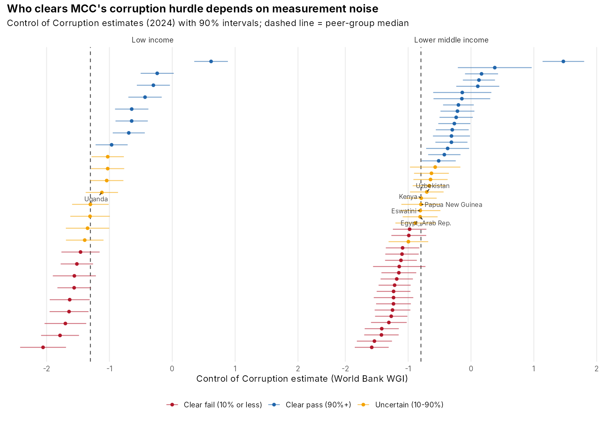
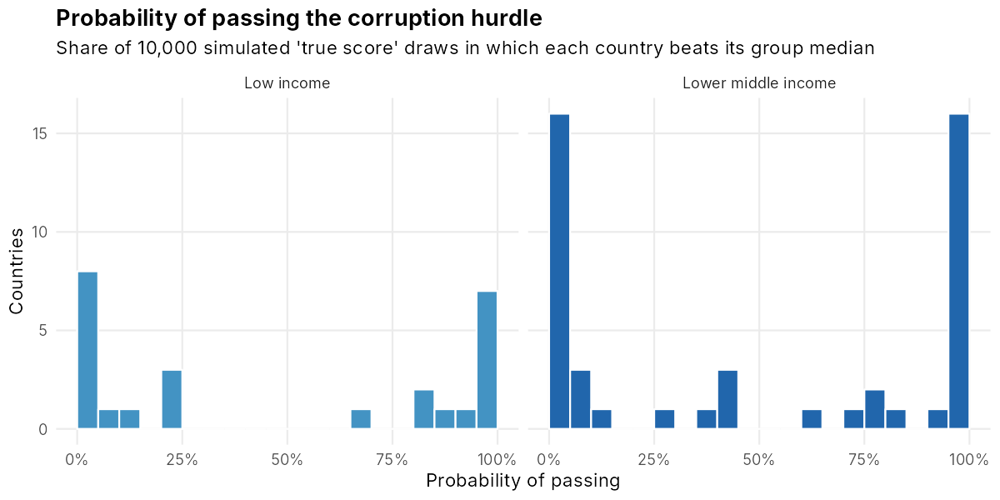
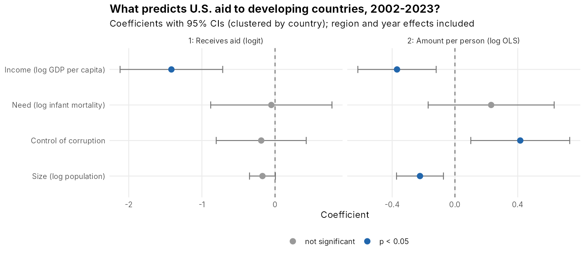
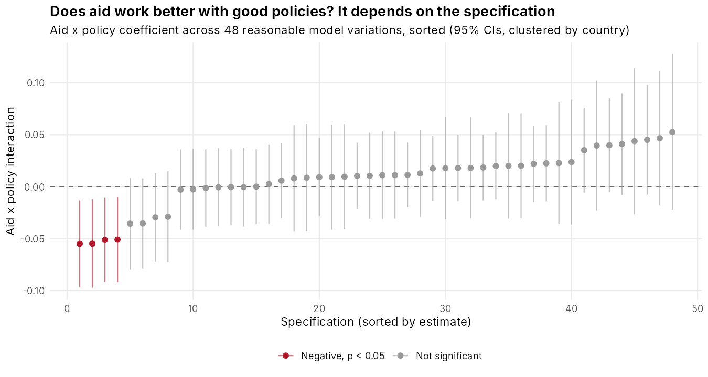
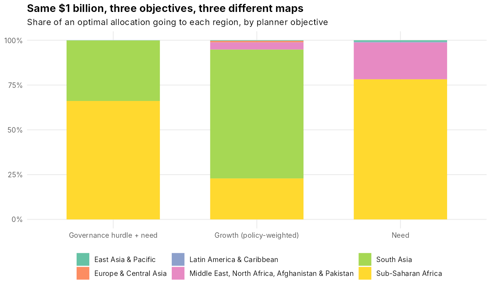

# The Mathematics of U.S. Foreign Aid Allocation: Testing the Methods with Data

**Allan Ross** · B.S. Statistics, Colorado Mesa University · Senior research paper (2025), extended 2026

Aid agencies use statistics to decide who gets money: percentile scorecards, median "hurdles", latent-variable governance scores, growth regressions and optimization. This project takes four of those methods and tests them on World Bank data for 1996–2024. In July 2025 USAID was closed and its remaining programs moved into the State Department, so how these rules work, and how much they depend on choices that look technical, is a live question.



## Key findings

| Question | Result |
|---|---|
| **1. Is the corruption hurdle measuring corruption or noise?** | Of 72 candidate countries in 2024, **19 (26%)** have between a 10% and 90% chance of truly being above their peer median once the World Bank's own margins of error are used. **Kenya officially passes and Papua New Guinea officially fails, but their scores differ by 0.004 and their chances of truly passing are nearly identical (43% vs. 44%).** All **26 of 26** year-to-year pass/fail changes since 2010 were smaller than the measurement noise. |
| **2. Does U.S. aid follow need?** | Across 125 developing countries (2002–2023), U.S. aid per person falls with income and rises with better corruption control (+52% per 1-point improvement), but **infant mortality has no significant effect** once income is accounted for. Larger countries get less per person (a 10% larger population means about 2% less aid per person). |
| **3. Does aid raise growth when policies are good?** | The Burnside–Dollar interaction is weakly positive in the baseline model (p = 0.08), but across **48 reasonable model variations, none** finds a significant positive effect and 4 find a significant *negative* one. |
| **4. How much does the objective matter?** | Allocating the same $1 billion by **need** vs. by **expected growth** keeps only **10%** of the money with the same countries. Sub-Saharan Africa gets 78% under a need objective and 23% under a growth objective. |

### 1. Corruption hurdle uncertainty
The Millennium Challenge Corporation (MCC) only funds countries that beat their income group's median on the World Bank's Control of Corruption score. That score comes from a statistical model that combines dozens of surveys and expert ratings, and the World Bank publishes a standard error for each country. Simulating 10,000 possible "true" scores per country shows that many pass/fail decisions are close to a coin flip.


### 2. Does U.S. aid follow need?
A two-part panel model with standard errors clustered by country: whether a country receives meaningful U.S. aid (> $1 per person), and how much per person among recipients.


### 3. Aid and growth: a specification curve
Burnside & Dollar (2000) reported that aid raises growth when policies are good; Easterly, Levine & Roodman (2004) found the result did not hold with more data. Re-running the model on 1996–2023 data in 48 defensible variations (policy index, sample, outliers, controls, functional form) shows how much the answer depends on analyst choices.


### 4. Allocation optimizer
A planner splits $1 billion across candidate countries with diminishing returns, `benefit = w × log(1 + aid / population)`, under three objectives: need (infant mortality), growth (policy-weighted) and an MCC-style governance hurdle plus need. The optimal allocation has a closed-form "water-filling" solution.


## Methods

| Step | Script | What it does |
|---|---|---|
| 1 | `R/01_get_data.R` | Downloads World Development Indicators and governance indicators via the WDI package |
| 2 | `R/02_clean.R` | Drops regional aggregates; builds aid per person and the country-year panel |
| 3 | `R/03_corruption_hurdle.R` | Monte Carlo pass probabilities for the MCC corruption hurdle; year-to-year flip analysis |
| 4 | `R/04_aid_need.R` | Two-part panel model of U.S. aid with region and year effects, country-clustered SEs |
| 5 | `R/05_aid_growth.R` | 4-year-period growth regressions with an aid × policy interaction; 48-specification curve |
| 6 | `R/06_allocation_optimizer.R` | Water-filling optimal allocation under three objectives; regional shares and overlap |

**Limitations.** Income groups use the World Bank's current classification for all years. U.S. aid is net bilateral official development assistance, which excludes security assistance and much of the strategic spending the literature emphasizes. The aid–need and aid–growth models show associations, not causal effects; aid goes to countries for reasons the models can't see (conflict, alliances), and growth also affects aid. The optimizer's benefit functions are deliberately simple illustrations of how objectives change outcomes, not estimates of actual impact. The corruption analysis uses one indicator and the median rule; MCC's full scorecard has 20 indicators and additional requirements.

## Reproduce

```r
install.packages(c("dplyr", "tidyr", "ggplot2", "scales", "sandwich", "lmtest", "ggrepel", "WDI"))
```
```bash
Rscript run_all.R            # uses data/wdi_raw.csv (included)
Rscript run_all.R --refresh  # re-downloads from the World Bank
```

Data: World Bank World Development Indicators and Worldwide Governance Indicators (public, CC BY 4.0).
